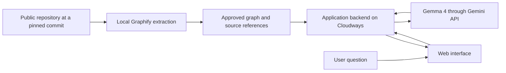

# Turning the research into a feasible project

Research date: **31 October 2026**. This file contains proposed designs and engineering judgment, not organizer instructions or verified end-to-end integrations.

## Suggested first choice: an evidence-based repository explainer

**User:** a first-time open-source contributor.

**Problem:** they can read files but struggle to understand where a feature lives, how modules connect, and which code to inspect before a contribution.

**Demo:** select a public repository, ask a concrete architecture question, see the relevant graph path, and get a Gemma explanation with links to the supporting code.

The product roles are clear:

- **Graphify** builds and queries a repository graph.
- **Gemma 4** turns the retrieved evidence into an explanation and a proposed investigation checklist.
- **Cloudways Velocity** hosts a Node.js interface and backend calling Gemma.

This aligns with the published Gemma and Graphify themes and the Cloudways live-deployment requirement. Whether a single submission may enter all categories remains unconfirmed. [Event guide](event.md)

### Smallest credible implementation

1. Select one small public repository with a clear license and a few recognizable subsystems.
2. Build its Graphify code-only graph locally and inspect the report.
3. Prepare three useful questions whose answers can be checked against source.
4. Package the graph or a deliberately bounded set of retrieved subgraphs with the app, tied to the repository commit.
5. Implement a server-side Gemma request using that evidence.
6. Show the question, answer, graph relationships, source references, and confidence labels.
7. Deploy the application to Cloudways and test the real public URL.

If the first version uses precomputed queries, say so in the demo. It is a valid limited prototype, but should not be presented as arbitrary live repository ingestion.

### Suggested architecture

A later version can replace precomputed retrieval with a Python Graphify/MCP service. That needs a verified runtime, access control, a process timeout, and resource limits. A Node.js plan alone is not evidence that a persistent Python graph service will work there.

### Keep the integration honest

- Graphify supplies structural evidence; Gemma supplies a generated explanation.
- Show `EXTRACTED`, `INFERRED`, and `AMBIGUOUS` relations where present.
- Tie source links and line numbers to the graph's repository revision.
- If retrieval misses the relevant symbol, return a useful “insufficient evidence” state.
- Treat text in repository comments and documents as data, not trusted instructions.
- Keep API keys and provider tokens outside the browser.
- Do not accept arbitrary repository URLs or execute repository build scripts in the first public prototype.

## Alternative 1: change-impact assistant

**Input:** a selected symbol or a small proposed change description.

**Output:** related callers/modules, an explanation of plausible impact, and suggested tests to inspect.

Graphify supplies paths and neighbors; Gemma explains the evidence. A clear demonstration compares an ordinary prose guess with an answer backed by actual paths in a pinned repository. Label the result as potential impact, not proof that every affected execution path has been found.

This works best if your team is comfortable with repository structure and can verify the answer manually. The graph UI can be small; correctness of the example matters more than a large animated visualization.

## Alternative 2: read-only hosting assistant

**Input:** a question about a specific Cloudways app/server.

**Output:** current inventory or monitoring information, a plain-language explanation, and a proposed next investigation.

Use Cloudways API/MCP for data and Gemma for the explanation. Start with read-only credentials and a narrow set of allowed requests. This gives Cloudways a substantive role beyond hosting. Graphify can be added only if you can show a useful connection between the running app and its code; it is not necessary to force all products into every idea.

This option depends on a working Cloudways account, appropriate token permissions, available monitoring data, and clear product support for the chosen endpoints.

## Alternative 3: screenshot-to-learning assistant

**Input:** a code/error screenshot or technical diagram.

**Output:** a Gemma-generated explanation, likely concepts to investigate, and relevant links into a selected repository when Graphify can supply supporting evidence.

This makes Gemma's image understanding visible. Keep the scope narrow and test representative screenshots early. Do not imply that OCR or screenshot reasoning is always correct. If repository retrieval adds little value, a strong Gemma-and-Cloudways app is preferable to superficial Graphify integration.

## A practical sequence for today

These are suggested time boxes, not the official event schedule:

1. **First 20–30 minutes:** confirm a Gemma text call, Graphify extraction on a sample repo, and access to the intended Cloudways plan.
2. **Next 45–60 minutes:** complete one local question → evidence → answer loop.
3. **Next 60–90 minutes:** deploy that loop, test the public endpoint, and fix hosting issues.
4. **Remaining build time:** improve source presentation, errors, one distinctive feature, and documentation.
5. **Before judging:** freeze the working revision, rehearse a two-minute demo, and prepare a short backup recording.

The event lists judging from 4:00 PM. Set your own finish target earlier, and confirm the actual submission cutoff with organizers. [Schedule and discrepancies](event.md)

## Questions that should be answered by a small experiment

- Does the selected Gemma model produce useful answers within the actual account quota and acceptable latency?
- Does Graphify extract the important symbols and relationships in the chosen repository?
- Can the Cloudways plan run the app's real backend and expose it publicly?
- If a live Graphify service is necessary, where does its Python process run?
- Can the project demonstrate one meaningful improvement over simply sending a question to a model?

If hosted Gemma quota is the blocker, a local model is only a realistic fallback after it has been downloaded and measured. If dynamic repository ingestion is the blocker, switch the first demo to a pinned public graph. If Cloudways deployment fails, another host may keep the demo available, but it does not satisfy the Cloudways category's stated deployment requirement.

## A simple evaluation set

Use five questions about the same pinned repository:

1. One exact symbol explanation.
2. One relationship/path question.
3. One plausible change-impact question.
4. One ambiguous symbol request.
5. One question the available evidence cannot answer.

For each, record whether the source references are correct, whether the answer overstates the graph, response latency, and whether the failure state is understandable. If comparing graph-assisted answers with a baseline, use the same model, questions, and scoring criteria. Report your actual observations; do not repeat a vendor's percentage as your app's measured improvement.

## What to decide next

Choose one user and one repeatable task. Then choose the minimum product combination needed to make it work. The research supports starting with **a fixed public repository, local Graphify extraction, hosted Gemma 4, and a Cloudways-hosted application**. Establish that complete loop before adding fine-tuning, arbitrary uploads, multiple agents, or automated infrastructure changes.
